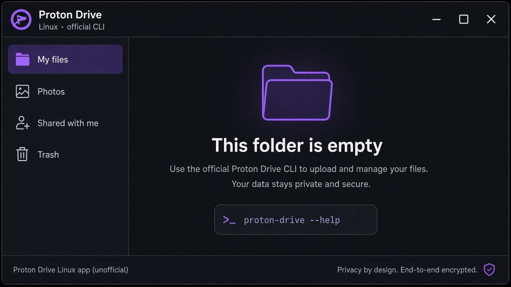
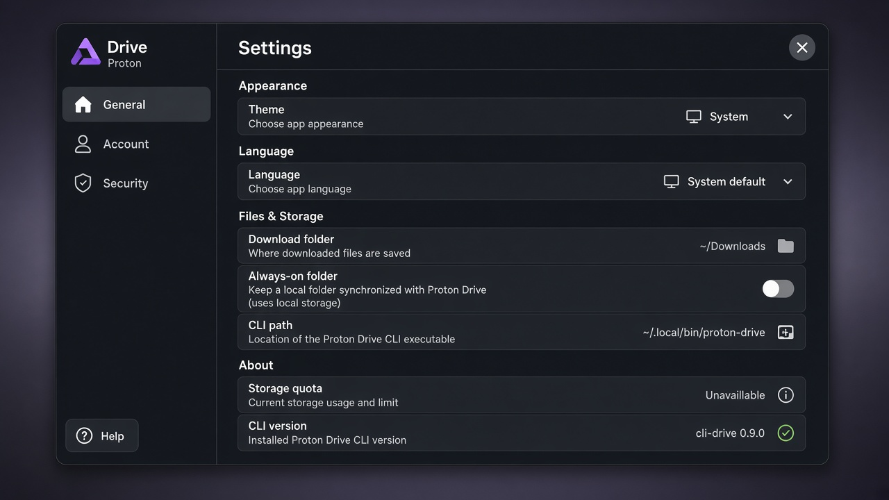
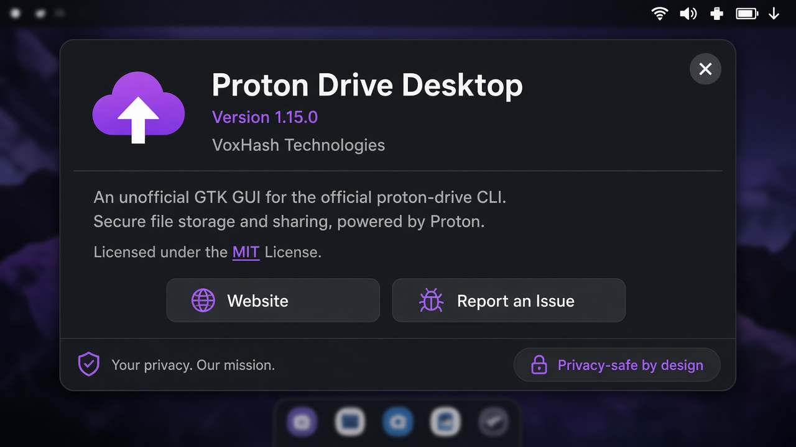
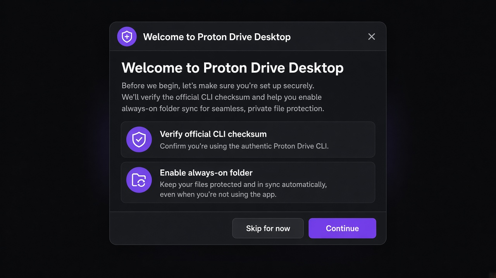

# Docs

- [Getting started](getting-started.md)
- [Quick start](quick-start.md)
- [Installation](installation.md)
- [Configuration](configuration.md)
- [Usage](usage.md)
- [CLI](cli.md)
- [API](api.md)
- [Architecture](architecture.md)
- [Security / threat model](../SECURITY.md)
- [Troubleshooting](troubleshooting.md)
- [FAQ](faq.md)
- [Example: list My files](examples/example-01.md)
- [Example: install, Guided setup, sync pairs, pause, Activity](examples/example-02.md)

## Screenshots

Privacy-safe engagement images (no real Drive listings, emails, or account identifiers):

| | |
| --- | --- |
|  |  |
|  |  |
